

  

<h1 align="center">Neerdhara · नीरधारा</h1>

<strong>Low-cost, flood-ready greywater management for Indian villages, with live sensor monitoring.</strong>

  
  
  
  

  <strong><a href="https://neerdhara.vercel.app">Live web dashboard</a></strong> ·
  <strong>Android app (APK): &lt;add APK link&gt;</strong> ·
  <strong>Demo video: &lt;add video link&gt;</strong> ·
  <strong><a href="docs/">Docs</a></strong>

## The problem

Village greywater treatment has to fit where land is scarce. Soak pits and filter units can overflow when grease
builds up, and monsoon flooding can make infiltration ineffective exactly when a safe bypass and fast response are
most important.

## Solution at a glance

| Treatment unit | Flood-ready design | Smart monitoring |
| --- | --- | --- |
| Low-cost, gravity-fed treatment. Works even when electronics are down. | Flood sensing and safe-flow response. Village-wide warning workflow. | ESP32 readings and clear status states. Role-based action from home to district. |

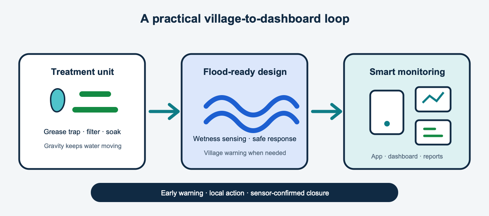

## How it works

1. **Sensor reads the tank** — level, high-water float, flood wetness, battery and signal.
2. **An alert opens** — configurable rules turn readings into a clear warning or critical state.
3. **The household tries first** — guided cleaning or a request for help from the Android app.
4. **The panchayat assigns an operator** — local staff see the issue, evidence and timeline.
5. **The operator fixes it** — checklist, before/after photos and an offline-capable field flow.
6. **The sensor confirms recovery** — normal readings close the alert with an audit trail.

In flood mode, affected units are shown together and the panchayat can queue a village warning. [Read the full flow](docs/02-how-it-works.md).

## Try it live

### How to log in

1. First time: enter the phone number, then the demo OTP **123456**, then set your own password.
2. Next time: phone number + your password.
3. If the account already has a password (someone else set it): tap **Forgot password**, enter OTP **123456**, and set a new password. So nobody gets locked out.

The web dashboard is for panchayat, officials and admin; household and operator use the Android app. First load may
take up to a minute while the server wakes up.

| Role | Where | Demo phone | What to look at |
| --- | --- | --- | --- |
| Household | Android app | +91 90000 00001 | Tank status, **I cleaned it** / **I need help**, report a problem |
| Field operator | Android app | +91 90000 00002 | Today's tasks, fix with before/after photos, install a new unit |
| Panchayat · Rampur | App and web | +91 90000 00003 | Assign alerts, approve new units, village flood alert |
| Block official | Web | +91 90000 00004 | Dashboard, village map, alerts, Flood Watch, report export |
| District official | Web | +91 90000 00005 | All blocks, village rankings, reports |
| Admin | Web | +91 90000 00006 | Villages, users, devices, alert rules, system health |

These are demo accounts with demo data only.

### Suggested two-minute tour

1. Log in as the **block official** and scan the dashboard status, trend and village ranking.
2. Open **Village Map**, select Rampur and inspect unit status pins.
3. Open **Alerts** to see the issue timeline and operator assignment flow.
4. Open **Flood Watch** to see village-level flood response and affected units.
5. Open **Reports** and preview a monthly scoped report.

## Screens

|  |  |  |
| --- | --- | --- |
| 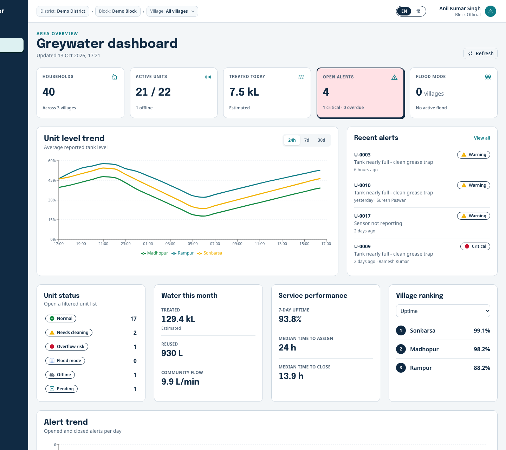 **Official dashboard** | 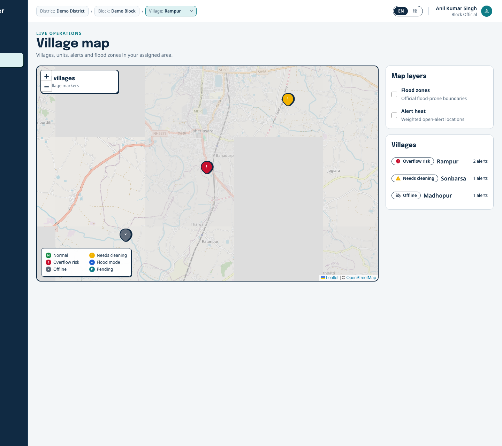 **Village map** | 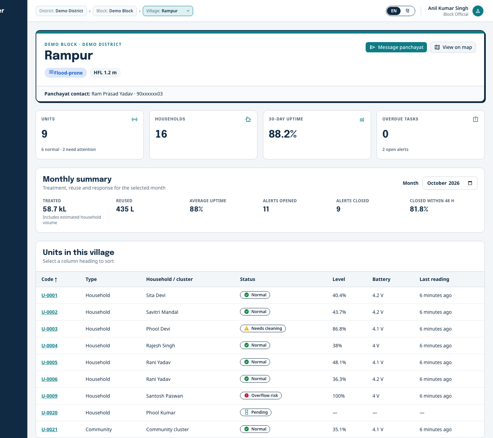 **Village overview** |
| 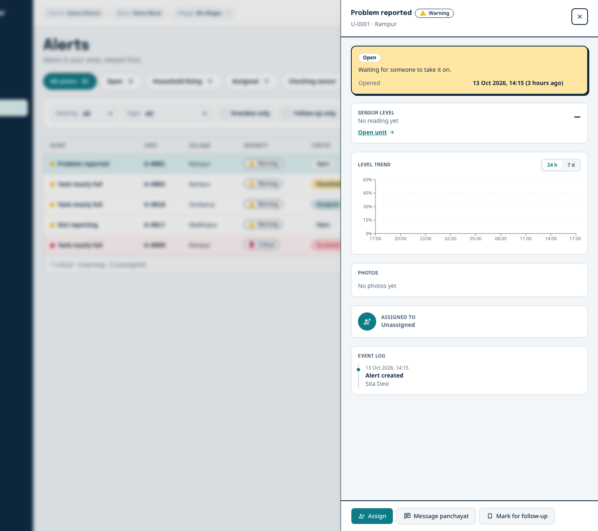 **Alert workflow** | 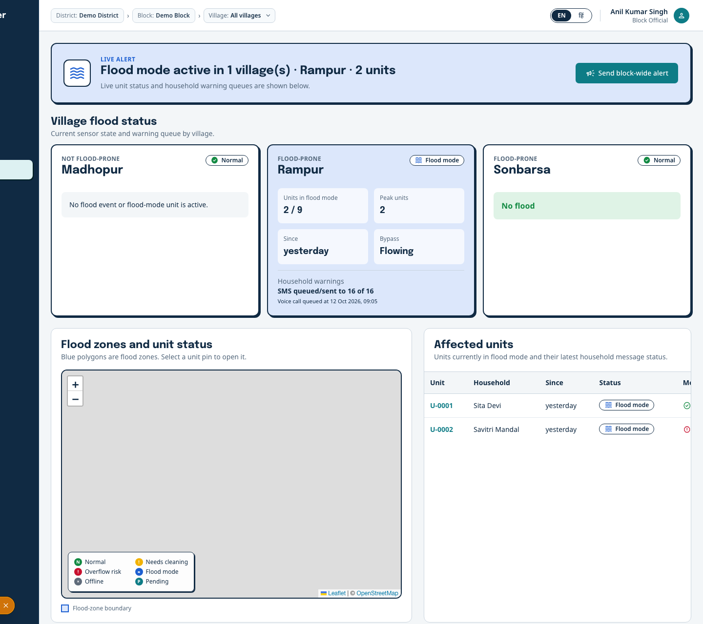 **Flood Watch** | 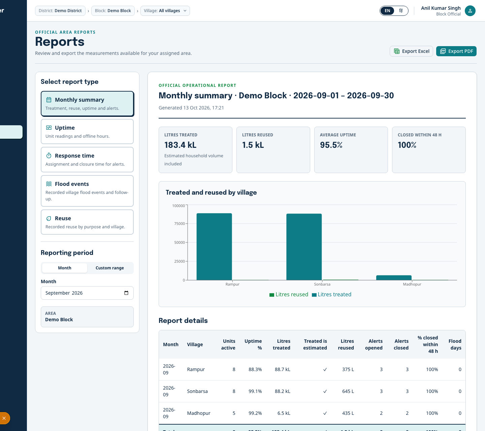 **Monthly reports** |

|  |  |  |  |
| --- | --- | --- | --- |
| 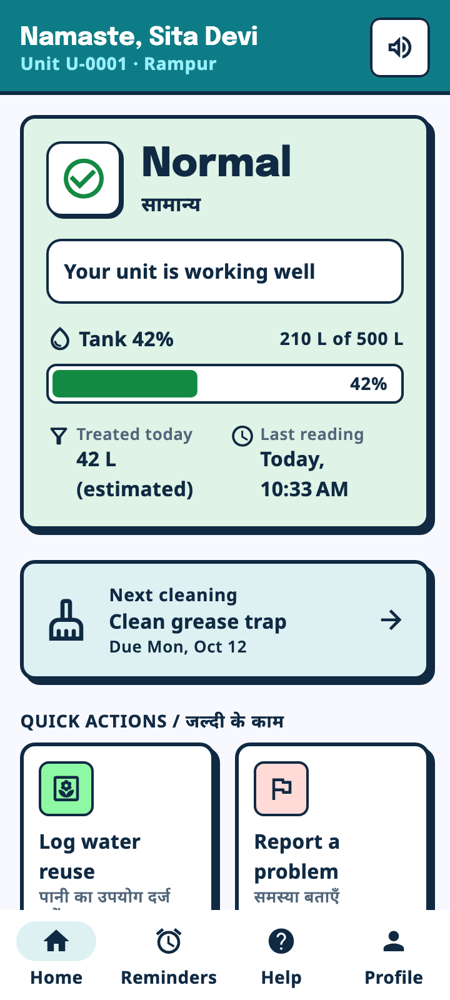 **Household home** | 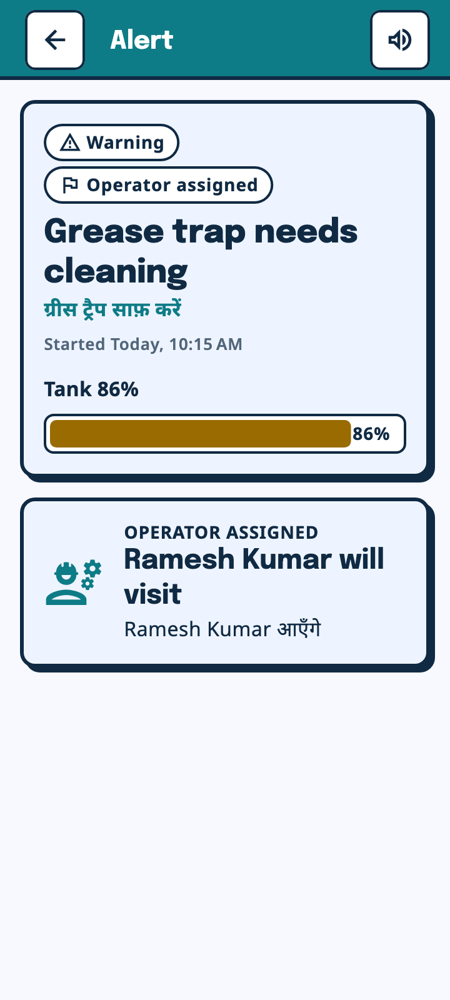 **Guided alert** | 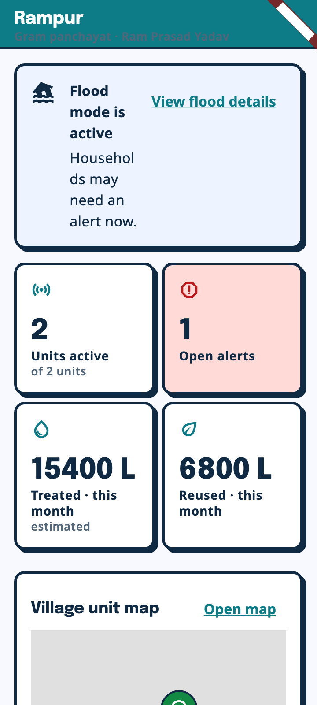 **Village flood** | 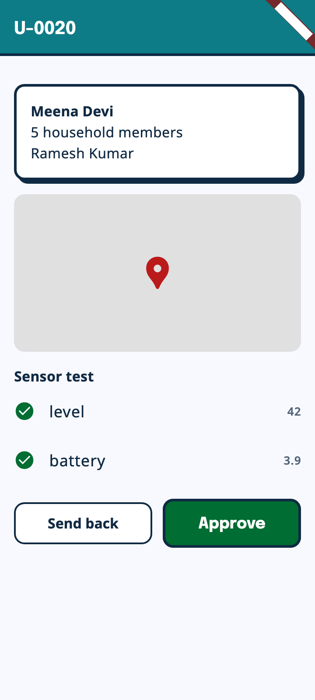 **Unit approval** |

[Browse all selected screenshots](screenshots/).

## Tech stack

**ESP32 · MQTT · FastAPI · PostgreSQL + PostGIS · Flutter · Next.js · offline-first sync**

[Why these choices](docs/08-tech-stack.md)

**Explore the documentation:**
[Problem and solution](docs/01-problem-and-solution.md) ·
[How it works](docs/02-how-it-works.md) ·
[Architecture](docs/03-architecture.md) ·
[Users and screens](docs/04-users-and-screens.md) ·
[Alerts and flood logic](docs/05-alerts-and-flood-logic.md) ·
[Sensor data](docs/06-sensor-data.md) ·
[Security and privacy](docs/07-security-and-privacy.md) ·
[Tech stack](docs/08-tech-stack.md) ·
[Demo story](docs/09-demo-story.md) ·
[Known limits](docs/10-known-limits.md)

## Honest status

- **Built and working:** role-based web and Android experiences, sensor ingest, alert/task workflows, maps, reports and administration.
- **Prototype hardware:** the ESP32 node and low-cost treatment concept are suitable for validation, not yet a certified production installation.
- **Simulated in the demo:** repeatable warning, recovery and flood readings; SMS and voice delivery are queued but not claimed as delivered.
- **Known limits:** external rainfall/river feeds, real voice receipts, operator location and node-side remote firmware apply are future work. [Full list](docs/10-known-limits.md).

## Team

| Name | Role |
| --- | --- |
| _Add name_ | _Add role_ |
| _Add name_ | _Add role_ |
| _Add name_ | _Add role_ |

The source code is private. This repository holds the documentation.

**License:** All rights reserved. See [LICENSE](LICENSE) and [license choices](LICENSE-CHOICE.md).

