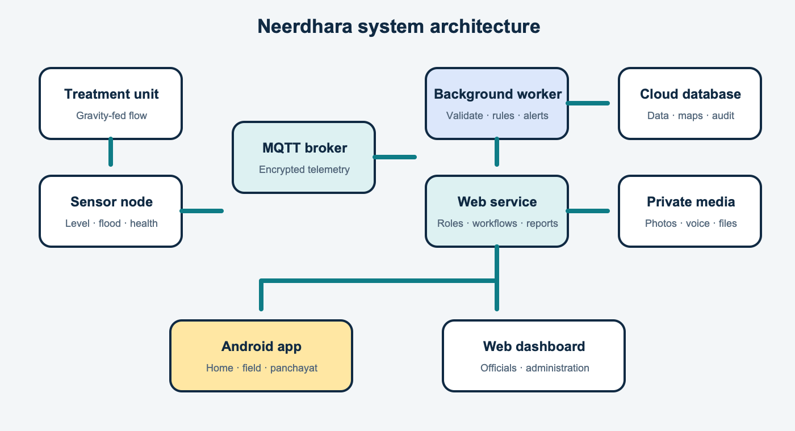

# Architecture

## Field layer

- Gravity-fed household and community treatment units.
- ESP32 sensor nodes with local sequence numbers and basic buffering.
- Android app for households, operators and panchayats.

## Messaging and service layer

- An MQTT broker accepts device readings over an encrypted connection.
- A background worker validates readings, removes duplicates and evaluates rules.
- A web service applies role and area permissions and coordinates workflows.

## Data layer

- A cloud database stores users, units, readings, alerts, tasks, reports and audit history.
- Spatial data supports village boundaries, flood zones and map layers.
- A private media store keeps photos, voice notes and firmware files.

## Experience layer

- A responsive web dashboard serves panchayat, block, district and admin workflows.
- The Android app provides role-specific, offline-aware field workflows.

The implementation technologies are listed in [08 · Tech stack](08-tech-stack.md); deployment vendors and internal
service addresses are intentionally outside this public architecture.

