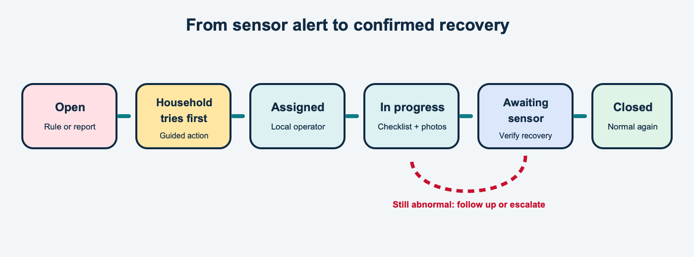

# Alerts and flood logic

## Alert lifecycle

An alert moves through plain operational states rather than disappearing after someone taps a button:

1. **Open:** a rule or household report creates the issue.
2. **Household fixing:** the household is trying the guided first response.
3. **Assigned:** the panchayat gives the issue to a field operator.
4. **In progress:** the operator starts the checklist and evidence capture.
5. **Awaiting sensor:** work is submitted but recovery still needs a reading.
6. **Closed:** readings confirm normal conditions or an authorised user closes it with a reason.
7. **Escalated:** unresolved work is visible to the next administrative level.

Level, turbidity, low-battery and offline thresholds, consecutive-reading requirements and response timers are
**configurable by admin**. The interface shows a shape and a word as well as colour for each status.

## Flood detection

A unit's flood-wet input puts it into flood mode. Village logic combines affected units with configurable village
thresholds to open a flood event. The event records its start, peak affected units and end after a configurable dry
period. Authorised users can queue household warnings for only the villages in their area.

The prototype does not claim live river level, rainfall forecasts or confirmed voice-call delivery.

